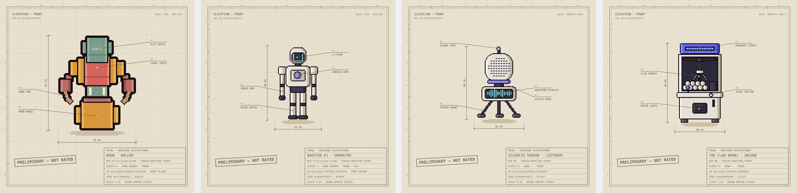
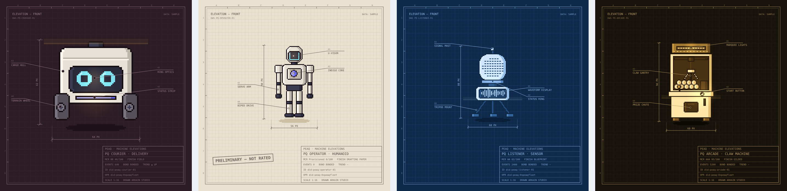

# Machine Elevations

**Every machine on peaq, drawn to scale.**

Machine Elevations draws each machine on [peaq](https://www.peaq.xyz/) as an architectural front elevation: dimension lines, callouts and a title block at scale 1:16. The drawing is generated from the machine's peaqID and its record in peaqOS. The same ID always gives the same drawing, and the drawing changes only when the record changes.

Live demo: **https://machine-elevations.vercel.app** · Methodology: **https://machine-elevations.vercel.app/methodology**



*Four real machines on peaq: Woon and Booster K1 read live from the MCR API, a Silencio sensor and The Claw #0981 drawn from their ID with the body for their machine type.*

## How data becomes a drawing

| peaqOS data | Drawing |
| --- | --- |
| peaqID (DID) | Hashed into a seed that picks the body, the name and the blink and breathing rhythm |
| Operator DID | The drafting grid, so a whole fleet is drawn on the same paper |
| Machine Credit Rating | The finish: Drafting Paper until rated, Field (B, BB), Night Shift (BBB, A), Blueprint (AA), Gilded (AAA) |
| Event count | How alive the core is: pulse, glow and scanner speed. No events, no scanner |
| Bond status | Bonded machines breathe and blink. Unbonded machines are greyed out with their eyes shut |
| Negative flag | A redline revision stamp: flagged, under review |
| Revenue trend, home chain | Recorded in the title block |

Nothing is random at draw time. Rendering uses only the seed and the record.

## The peaq series

The demo borrows bodies from GRID_ARCHITECT_SERIES. The production version gets its own modular body system, drawn only for peaq in white, indigo and cyan. The first four prototypes, PQ Courier (delivery robot), PQ Operator (humanoid), PQ Listener (sensor) and PQ Arcade (claw machine), are shown on the demo page. Bodies are picked by machine type: sensors are drawn as the Listener, humanoids as the Operator and claw machines as the Arcade.




## Project structure

```
index.html          demo page
methodology.html    how the data maps to the drawing
css/                page styles
js/units.js         GRID_ARCHITECT_SERIES robot sprites (artwork, see Licence)
js/peaq-units.js    peaq series bodies: Courier, Operator, Listener, Arcade
js/engine.js        deterministic renderer: DID hash, seed, finishes, Sheet class
js/app.js           demo page: form, live fetch, sheet index
js/methodology.js   figures on the methodology page
api/mcr.js          serverless proxy to the peaq MCR API (5 min cache)
api/did.js          experimental: reads a legacy did:peaq:0x... DID from the peaq chain (read-only)
assets/             favicon and social preview image
docs/               images for this README
```

No build step and no dependencies: the site is static files plus one Vercel function.

## Data source

Records come from the public peaqOS Machine Credit Rating API:

- `https://mcr.peaq.xyz/mcr/did:peaq:<machine id>` for machines homed on peaq
- `https://mcr-20.peaq.xyz/mcr/did:peaq:<machine id>` for machines homed on Solana

Activated machines can be browsed at the [peaq Machine Explorer](https://machines.peaq.xyz/). If the browser cannot read the API directly, the demo accepts the API's JSON response pasted in.

## Run it

Serve the folder with any static server, for example `python3 -m http.server` or `npx serve .`, and open it in a browser. The live API proxy in `api/` runs on Vercel, or locally with `vercel dev`.

## Status

This is the proof of concept for a peaq ecosystem grant proposal. Planned next:

1. An open-source rendering library with a live data adapter and determinism tests
2. A new body system drawn for peaq machine types, and an image and metadata service per DID
3. Elevation certificates: a dated, verifiable snapshot of a machine's identity, rating and history
4. A public gallery, fleet sheets per operator, and an embeddable widget for DePIN apps

## Credits and licence

Designed and built by Amir Keshavarzian ([Arkain](https://x.com/ArkainArt)), [ARKAIN STUDIO](https://www.arkain.studio/).

- Code: MIT licence (see `LICENSE`)
- Artwork: the GRID_ARCHITECT_SERIES bodies (`js/units.js`) are © ARKAIN STUDIO and used here for the demo only. The peaq series bodies (`js/peaq-units.js`) and the artwork made for the peaq version will be released under CC BY 4.0.

## Changelog

- **v0.5.2 (10 Nov 2026):** experimental `api/did.js`, a read-only reader for legacy `did:peaq:0x...` DIDs: EVM addresses through the DID precompile, 32-byte accounts through the `peaqdid_readAttribute` RPC.
- **v0.5.1 (7 Nov 2026):** methodology page gets a sticky contents sidebar and a centred reading column; sheet index tiles align and show the selected machine with an ink outline.
- **v0.5.0 (7 Nov 2026):** the site is split into separate HTML, CSS and JS files; social preview image, favicon and page metadata; LICENSE file; README images and project structure.
- **v0.4.2 (7 Nov 2026):** new PQ Arcade body for claw machines, with The Claw #0981 by DualMint in the sheet index; claw machine added to the Type field.
- **v0.4.1 (7 Nov 2026):** the real Booster K1 (a humanoid in the peaq Machine Explorer) is now named and drawn as a PQ Operator; humanoid added to the Type field.
- **v0.4.0 (6 Nov 2026):** PQ Listener, the first body picked by machine type (any sensor is drawn as a Listener); a Type field in the form; a real Silencio sensor in the sheet index.
- **v0.3.0 (5 Nov 2026):** robotics interface (plotter reveal, CAD crosshair and coordinates, live API status), animated thumbnails, peaq series prototypes (PQ Courier, PQ Operator), methodology page.
- **v0.2.0 (4 Nov 2026):** live MCR records through `/api/mcr`, Solana-homed machines, legacy DID handling.
- **v0.1.0 (3 Nov 2026):** first demo with sample fleet and pasted API data.
